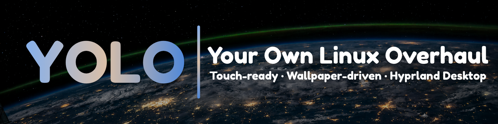
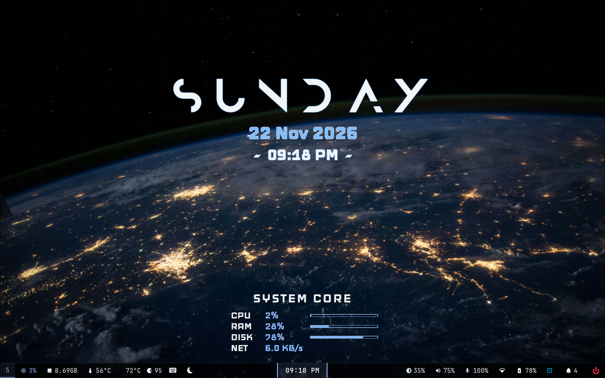
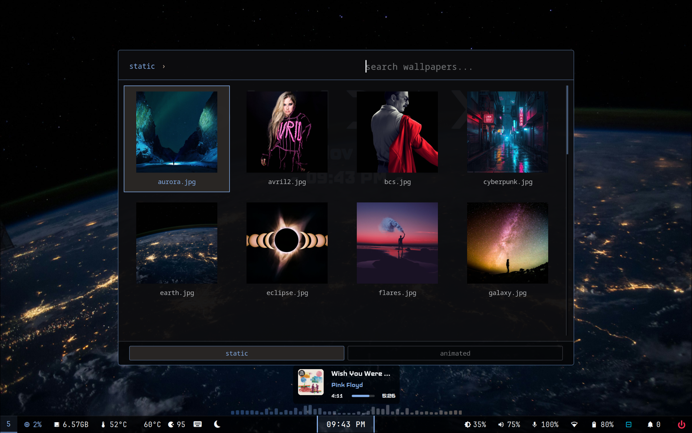
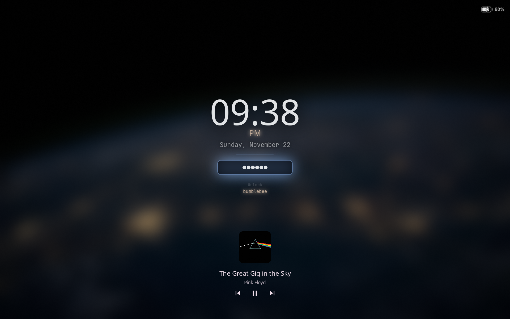
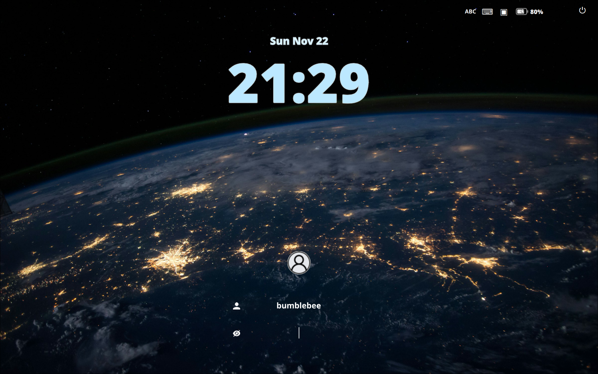
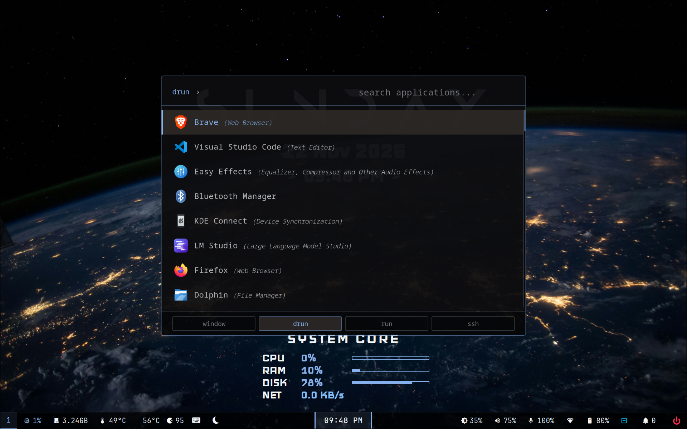
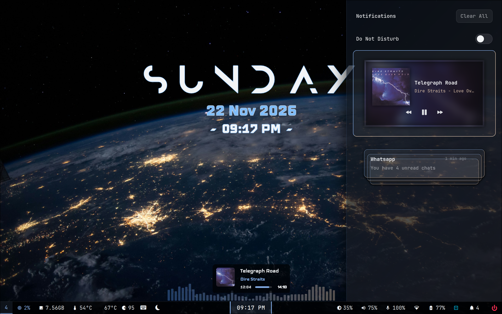
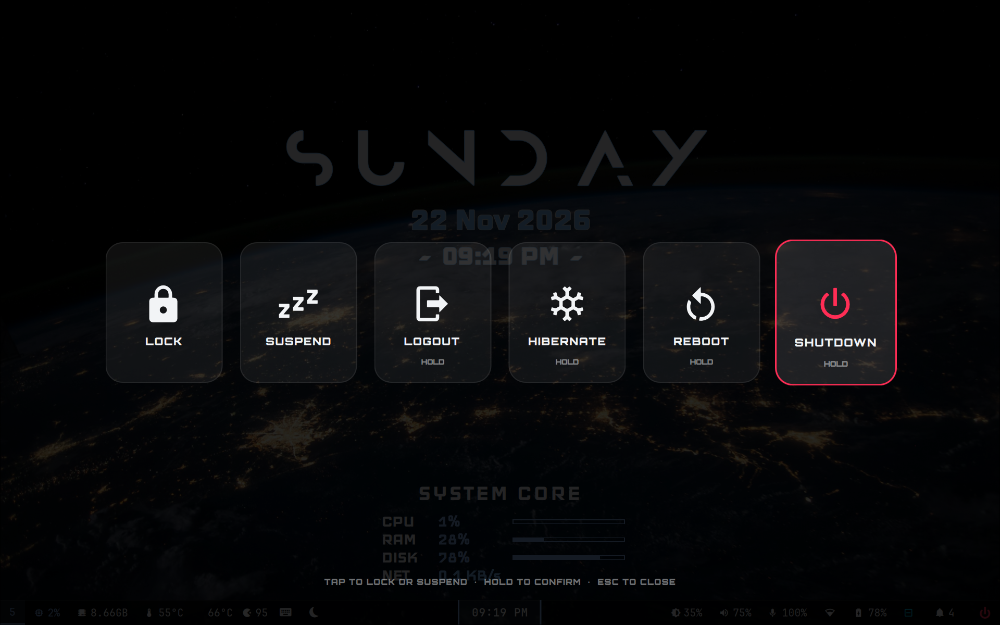
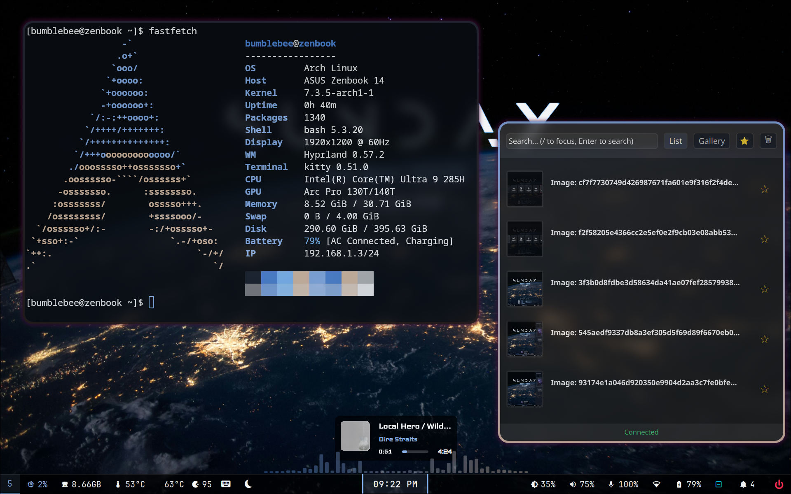

<a id="top"></a>

<p align="center">
  
</p>

<div align="center">

<a href="https://github.com/Bumblebee-3/YOLO/stargazers">
  
</a>
<a href="https://github.com/Bumblebee-3/YOLO/commits/main">
  
</a>
<a href="LICENSE">
  
</a>

</div>


<div align="center">

<br>

<a href="#installation"></a>
<a href="#features"></a>
<a href="#wallpapers"></a>
<a href="#styles"></a>
<br>
<a href="#keybindings"></a>
<a href="#updating"></a>
<a href="#contributing"></a>
<a href="#credits"></a>

<br>

</div>


<div align="center">


</div>

<br>

**YOLO** (Your Own Linux Overhaul) is a wallpaper-driven Hyprland desktop for Arch. Pick a wallpaper, and the bar, launcher, terminal, notifications, lock screen, login screen, GTK/Qt apps and even Firefox all recolor to match.

<br>

<a id="installation"></a>

---

YOLO targets an **x86-64 Arch Linux** install with a working internet connection, a normal user with `sudo`, and `python`. Other distros are not supported, and the installer refuses to run without `/etc/arch-release`.


> [!CAUTION]
> The installer upgrades your system with pacman, switches your display manager to **SDDM** (effective next boot), installs sudo rules for the greeter theme, and builds SwayOSD and Circle Search from source. Your previous display manager and boot target are recorded in `/var/backups/yolo/RUN/service-state.txt` so you can roll back.

The SDDM battery indicator builds from `plugins/TahoeBattery` during installation, staging and restore. These modes require CMake, a C++17 compiler and Qt 6 Core/QML development files. The installer deploys the module into the installed Qt's QML directory. The indicator polls Linux power supplies every 30 seconds, displays the first present system battery in name order, and hides when none is present. The lightning bolt indicates external power, including when a charge threshold pauses charging.

Circle Search uses the host Rust target on a full install. Both the keyboard shortcut and touch keyboard launch `~/.local/bin/circle`. Visual searches require Firefox on PATH. A restore-only run (`-r`) keeps the existing executable.


> [!WARNING]
> The `hw-zenbook` tier is for the matching ASUS Zenbook only (display scaling, stylus, NumberPad, power limits). Leave it off on any other machine.

```shell
sudo pacman -S --needed git git-lfs base-devel
git clone https://github.com/Bumblebee-3/YOLO.git ~/YOLO
cd ~/YOLO
git lfs pull
./install.sh --dry-run   # preview, changes nothing
./install.sh             # the real thing
```

Reboot, then pick **YOLO (Hyprland)** in SDDM.

> [!TIP]
> Want extras? Tiers stack: `./install.sh touch extra dev`
>
> | Tier | Adds |
> |---|---|
> | `core` | Always on. Desktop, greeter, widgets, wallpapers, recording tools, Hyprspace overview (three-finger touchpad swipe up or Super + Tab), Memoria clipboard (Super + V) |
> | `touch` | Hyprgrass gestures and the desktop on-screen keyboard |
> | `hw-zenbook` | Zenbook-only profile (Do not use unless you have ux3405CA spec ultra 9 285H, Has specialised power modes for this system, that could potentially break your laptop.) |
> | `extra` | KDE Connect, scrcpy, Android tools |
> | `dev` | git, ShellCheck, StyLua |
> | `lower-ram-usage` | Removes QuickShell widgets from home screen; reduces ram usage by about 400-500mb. |

Use `./install.sh lower-ram-usage` on a desktop or add it to your existing tiers. Reinstall without `lower-ram-usage` (for example, `./install.sh -r core touch`) to restore the widgets. The change takes effect at the next login. With `touch` enabled, the on-screen keyboard remains available from Waybar. Screen recording and touchscreen gestures still work. The SDDM login keyboard is separate from the QuickShell desktop keyboard and remains available at login.

> [!NOTE]
> Want to see exactly what lands where first? `./install.sh --stage "$PWD/local/preview"` writes a full copy into `local/preview/` without touching your system.


<a id="features"></a>

---

<div align="center">
<table>
<tr>
<td align="center" width="33%">
<b>Wallpaper colors</b><br><br>
One palette extracted from the wallpaper feeds ~12 apps. Change the image, everything follows.
</td>
<td align="center" width="33%">
<b>Sky that tells time</b><br><br>
<code>dynsky</code> renders the real sun, moon phase and stars for your location and crossfades through the day.
</td>
<td align="center" width="33%">
<b>Touch ready</b><br><br>
On-screen keyboard, Hyprgrass gestures, bottom-swipe overview, hold-to-confirm power menu.
</td>
</tr>
<tr>
<td align="center">
<b>Tahoe-style login</b><br><br>
Custom SDDM greeter with animated wallpaper, battery, session picker and a virtual keyboard.
</td>
<td align="center">
<b>Screen recorder</b><br><br>
Region capture with mic or system audio, pause/resume, a REC overlay, and one-click GIF export.
</td>
<td align="center">
<b>Keybinding editor</b><br><br>
Remap anything from a GUI. Your changes live outside the repo, so updates never clobber them.
</td>
</tr>
<tr>
<td align="center">
<b>Safe installer</b><br><br>
Dry-run, staging, per-file backups, restore mode. Nothing is replaced without a copy.
</td>
<td align="center">
<b>Live widgets</b><br><br>
QuickShell clock, System Core stats, Now Playing and a cava visualizer, all palette-aware.
</td>
<td align="center">
<b>Update notifier</b><br><br>
Checks GitHub every six hours and offers a one-click update in Kitty.
</td>
</tr>
</table>
</div>

<a id="wallpapers"></a>

---

Press `Super + W` to open the picker. Static images live in `~/.config/yolo/wallpapers/oledwall` and animated GIFs in `~/.config/yolo/wallpapers/animwall`. To bring over a personal collection from an older installation, copy its files into the matching folder. Keep any adjacent `.dynsky` directories with their wallpapers.

Picking one regenerates the palette and re-themes Waybar, Rofi, SwayNC, Kitty, btop, Fastfetch, GTK 3/4, Qt 5/6, KDE, Hyprland borders, Hyprlock, SDDM, and Firefox (when [pywalfox](https://github.com/Frewacom/pywalfox) is installed).

### Palette from a single image

<div align="center">

[](#wallpapers)
[](#wallpapers)
[](#wallpapers)
[](#wallpapers)
[](#wallpapers)

</div>

<sub>Example from the default Outer Space wallpaper. Every wallpaper generates its own set.</sub>

<a id="styles"></a>

---

<div align="center">


&nbsp;


<sub><b>Desktop</b> &nbsp;&nbsp;·&nbsp;&nbsp; <b>Wallpaper picker</b></sub>

</div>


<div align="center">


&nbsp;


<sub><b>Hyprlock</b> &nbsp;&nbsp;·&nbsp;&nbsp; <b>Login screen</b></sub>

</div>


<div align="center">


&nbsp;


<sub><b>Application picker</b> &nbsp;&nbsp;·&nbsp;&nbsp; <b>Notification center</b></sub>

</div>


<div align="center">


&nbsp;


<sub><b>Power menu</b> &nbsp;&nbsp;·&nbsp;&nbsp; <b>Memoria &amp; system tools</b></sub>

</div>


<a id="keybindings"></a>

---

Press `Super + Shift + K` any time to open the keybindings editor. It also opens automatically on your first login.

<div align="center">

| Keys | Action | Keys | Action |
|:---|:---|:---|:---|
| <kbd>Super</kbd> + <kbd>Q</kbd> | Terminal | <kbd>Super</kbd> + <kbd>W</kbd> | Wallpaper picker |
| <kbd>Super</kbd> + <kbd>A</kbd> | App launcher | <kbd>Super</kbd> + <kbd>L</kbd> | Lock screen |
| <kbd>Super</kbd> + <kbd>E</kbd> | File manager | <kbd>Super</kbd> + <kbd>C</kbd> | Close window |
| <kbd>Super</kbd> + <kbd>F</kbd> | Browser | <kbd>Super</kbd> + <kbd>U</kbd> | Toggle floating |
| <kbd>Super</kbd> + <kbd>V</kbd> | Clipboard history | <kbd>Super</kbd> + <kbd>J</kbd> | Switch tiling layout |
| <kbd>Super</kbd> + <kbd>.</kbd> | Emoji picker | <kbd>Super</kbd> + <kbd>1</kbd>..<kbd>0</kbd> | Workspaces |
| <kbd>Print</kbd> | Region screenshot | <kbd>Super</kbd> + <kbd>S</kbd> | Special workspace |
| <kbd>Ctrl</kbd> + <kbd>Shift</kbd> + <kbd>Esc</kbd> | Task manager | <kbd>Super</kbd> + <kbd>M</kbd> | Exit Hyprland |

</div>

Screen recording starts unassigned. Bind `record`, `record-mic`, `record-system` and `record-pause` in the editor.


<a id="updating"></a>

---

YOLO checks GitHub two minutes after login and every six hours after that. Choose **Install update** in the notification to run the updater in Kitty.

Doing it by hand:

```shell
cd ~/YOLO
git pull
git lfs pull
./install.sh -r          # restore files only, skips packages
```

Run a full `./install.sh` (without `-r`) whenever a package list changes. Use the same tiers you installed with.

> [!IMPORTANT]
> Any config you edited gets overwritten if it is listed in `manifest.psv`. Every replaced file is backed up first to `~/.config/cfg_backups/RUN/` (user) or `/var/backups/yolo/RUN/` (system). Put permanent personal tweaks in `local/home/`, which wins on restore and is git-ignored.

<details>
<summary><b>Recovering a replaced file</b></summary>

```shell
cp -a --remove-destination \
  ~/.config/cfg_backups/RUN/.config/kitty/kitty.conf \
  ~/.config/kitty/kitty.conf
```

Replace `RUN` with the ID the installer printed. For a broken login screen, switch to a TTY, read `service-state.txt`, disable SDDM and re-enable your previous manager.

</details>


<a id="contributing"></a>

---

PRs and issues are welcome, whether it is code, testing on different hardware, or docs.

1. Fork, then branch from `main`.
2. Install the `dev` tier for ShellCheck and StyLua.
3. Test with `./install.sh --dry-run` and `--stage` before touching a real system.
4. New file? Add it to `manifest.psv` under the right tier.
5. Run `shellcheck` on shell scripts and `stylua` on Lua.
6. In the PR, say what you changed and what hardware you tested on.

<details>
<summary><b>Repo layout</b></summary>

```
YOLO/
├── install.sh        entry point
├── manifest.psv      tier -> source -> destination
├── lib/              installer helpers (deploy.py, pkg.sh, ...)
├── hooks/            service enabling
├── pkgs/             package lists per tier
├── configs/          dotfiles -> ~/.config and ~/.local
├── profiles/         hw-zenbook, touch, extra
├── system/           SDDM theme, session entry, sudoers, libexec
├── themes/           oledwall + animwall
└── vendor/           SwayOSD and Circle Search sources
```

</details>


## Contributors

<a href="https://github.com/Bumblebee-3/YOLO/graphs/contributors">
  
</a>

## Assets and license

<br>
<a id="credits"></a>


YOLO is glued together from a lot of excellent projects.

- [Hyprland](https://github.com/hyprwm/Hyprland), Hyprlock, hyprpm
- [Hyprgrass](https://github.com/horriblename/hyprgrass) (Bumblebee-3 fork) and [Hyprspace](https://github.com/KZDKM/Hyprspace) (KZDKM)
- [SwayOSD](https://github.com/ErikReider/SwayOSD) by Erik Reider (Bumblebee-3 fork, vendored)
- [sddm-astronaut-theme](https://github.com/Keyitdev/sddm-astronaut-theme) by Keyitdev, built on [Sugar Dark](https://github.com/MarianArlt/sddm-sugar-dark) by MarianArlt
- [Quickshell](https://quickshell.org), [Waybar](https://github.com/Alexays/Waybar), [Rofi](https://github.com/davatorium/rofi), [rofimoji](https://github.com/fdw/rofimoji), [SwayNC](https://github.com/ErikReider/SwayNotificationCenter), [awww](https://codeberg.org/LGFae/awww), [Kitty](https://github.com/kovidgoyal/kitty)
- [cava](https://github.com/karlstav/cava) and its shaders, including work by rezky_nightky and ChunderFPV
- [Memoria](https://github.com/Bumblebee-3/memoria) clipboard manager (Bumblebee-3)

<br>
<a id="wallpaper-credits"></a>


A huge thanks to the photographers and creators whose work helps bring YOLO's desktop to life.

The following wallpapers are sourced from [Unsplash](https://unsplash.com) and made available under the [Unsplash License](https://unsplash.com/license).

| Filename | Wallpaper | Creator | Source |
|:---|:---|:---|:---|
| `eclipse.jpg` | Solar Eclipse | Bryan Goff | [Unsplash](https://unsplash.com/photos/we1ky8_ZTHg) |
| `smoke-silhouette.jpg` | Silhouette with Smoke | Aziz Acharki | [Unsplash](https://unsplash.com/photos/7nsqPSnYCoY) |
| `northern-lights.jpg` | Northern Lights | Jonatan Pie | [Unsplash](https://unsplash.com/photos/3l3RwQdHRHg) |
| `outer-space.jpg` | Outer Space | NASA | [Unsplash](https://unsplash.com/photos/Q1p7bh3SHj8) |
| `starry-silhouette.jpg` | Silhouette Under the Stars | Greg Rakozy | [Unsplash](https://unsplash.com/photos/oMpAz-DN-9I) |
| `molten-lava.jpg` | Molten Lava - Kalapana | Buzz Andersen | [Unsplash](https://unsplash.com/photos/E4944K_4SvI) |

These wallpapers remain the work of their respective creators and are distributed under the Unsplash License, independently of YOLO's GPL-3.0-or-later software license.

<br>
<a id="license"></a>


YOLO (Your Own Linux Overhaul) is licensed under the GNU General Public License v3.0 (GPL-3.0).

Copyright (C) 2026 Bumblebee-3

This project is free software: you can redistribute it and/or modify it under the terms of the GNU General Public License, version 3, or (at your option) any later version.

See the [LICENSE](LICENSE) file for the full license text.
